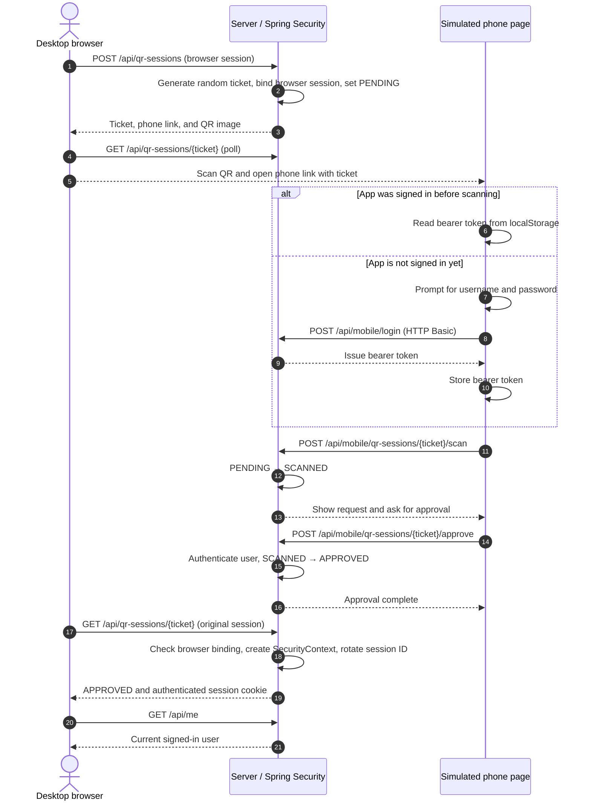
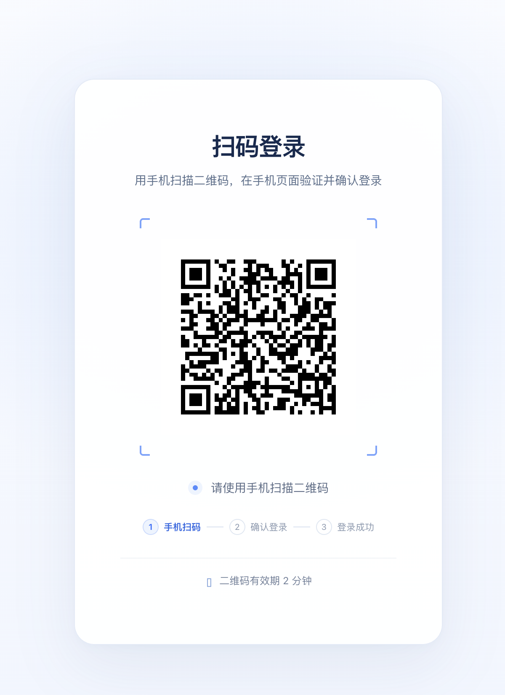
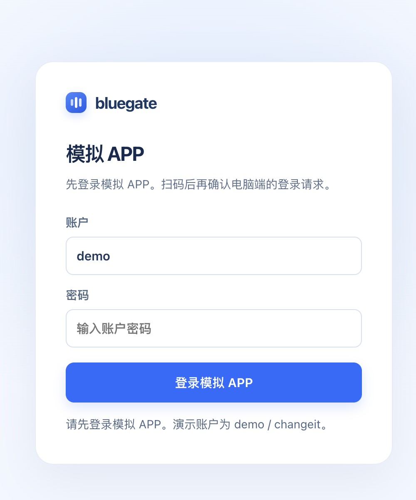
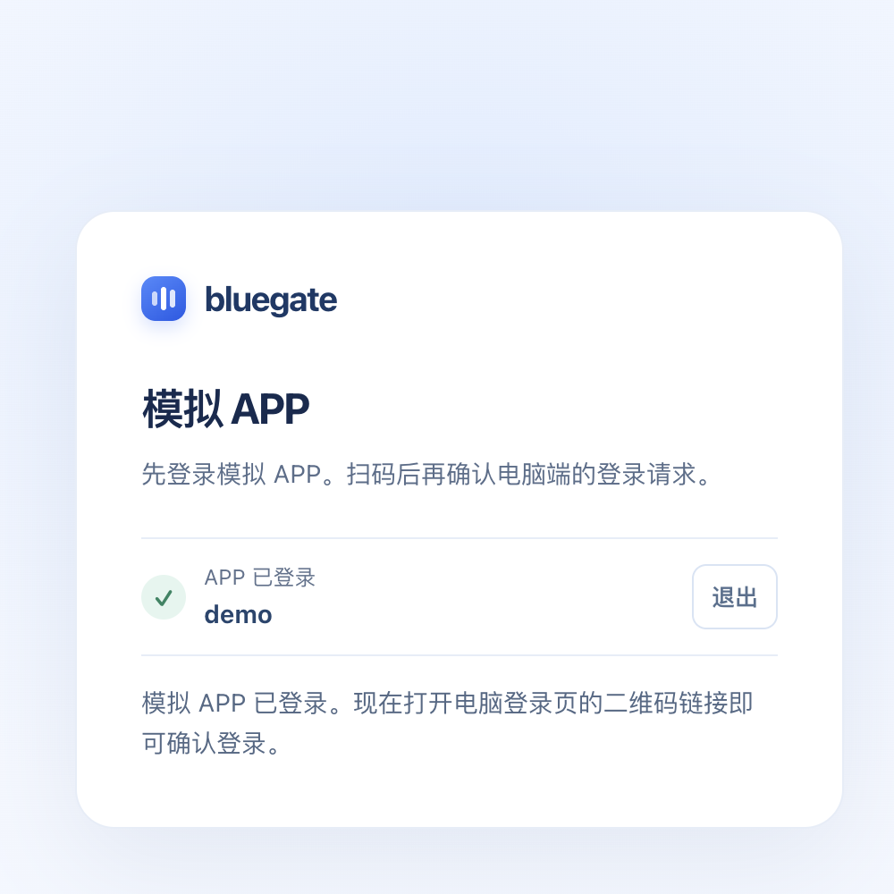

# Spring Security QR Login Demo

[](https://spring.io/projects/spring-boot)
[](https://openjdk.org/)
[](https://maven.apache.org/wrapper/)
[](LICENSE)

[简体中文](README.zh-CN.md) | **English**

A runnable example of self-hosted QR code login with Spring Boot 4.1.2 and Spring Security. A desktop browser starts a login request, a phone client (simulated by a web page) scans and approves it, and the server signs in the original browser session.

QR login is not provided out of the box by Spring Security. In this example, Spring Security authenticates users, protects the mobile APIs, and creates and saves the desktop browser's security context. The application implements QR tickets, state transitions, approval rules, and the association between the phone and the browser.

## How QR login works

### Clients and credentials

The flow has three participants: the desktop browser, the phone client, and the server. It uses three distinct credentials:

| Credential | Purpose | Example behavior |
| --- | --- | --- |
| Browser HTTP session (`JSESSIONID`) | Identifies the desktop browser that started login | The server binds the QR request to this browser session |
| QR ticket (`ticket`) | Identifies one QR login request | Randomly generated, expires in 2 minutes, and does not authenticate a user by itself |
| Mobile bearer token | Proves which account is signed in on the phone | Issued after signing in to the simulated app and sent with scan and approval requests |

The desktop page creates a QR login session and displays a QR code containing a phone page URL with a `ticket`. When the phone opens the link, the server changes the request from `PENDING` to `SCANNED`. If the phone is not signed in yet, the user signs in to the simulated app first and the page then scans automatically. After the user explicitly approves the request, it becomes `APPROVED` and stores the username authenticated by Spring Security. The original browser polls the result; the server reloads that user's authorities, creates a `SecurityContext`, rotates the session ID, and saves the context to the browser's HTTP session.



The states mean:

- `PENDING`: The browser created the request; it has not been scanned.
- `SCANNED`: The phone recognized the request; the user still needs to approve it.
- `APPROVED`: The signed-in phone user approved it; the original browser can now complete login.
- `EXPIRED`: The 2-minute lifetime elapsed. Create a new QR code to try again.

**Scanning is not the same as signing in; approval is the authorization step.** The phone approves a short-lived request bound to the original browser. The phone's bearer token is never copied to the desktop. Only the browser session that created the request can complete login through polling.

## Run locally

Requires Java 25. The project includes the Maven Wrapper:

```bash
./mvnw spring-boot:run
```

Open the desktop login page at <http://localhost:8080> and the simulated app at <http://localhost:8080/mobile.html>. The demo account is:

```text
Username: demo
Password: changeit
```

The desktop page looks like this. The QR code below is for illustration only and expires within 2 minutes. Start the app and scan a newly generated QR code for a live demo.



### Demo A: Sign in to the simulated app before scanning

1. Open <http://localhost:8080/mobile.html> in one browser tab.
2. Enter `demo / changeit` and select **Sign in to simulated app**. The page should show `APP signed in: demo`; the simulated app now has a bearer token.
3. In another tab in the same browser, open <http://localhost:8080> and wait for the QR code.
4. Scan the QR code or open its phone link. Pages on the same origin share `localStorage`, so the phone page reads the existing token and marks the request as scanned automatically.
5. Review the request on the phone page and select **Approve and sign in on desktop**. Return to the desktop tab to see the completed login.





### Demo B: Sign in to the simulated app after scanning

This path simulates a phone that is not signed in when it scans the QR code. If you just completed Demo A, select **Sign out** on the simulated app page. Also sign out of the desktop account or use a fresh browser session if the desktop is already signed in.

1. Open <http://localhost:8080> and wait for a new QR code.
2. Scan the QR code and open the phone link containing the `ticket`.
3. The phone page displays the sign-in form. Enter `demo / changeit` and submit it.
4. After sign-in succeeds, the page stores a bearer token and automatically uses it to mark the current QR request as scanned. The approval button then appears.
5. Review the request, approve it, and wait for the desktop page to complete login.

The only difference between these paths is when the phone obtains its bearer token. Both require an explicit approval before the desktop browser signs in.

## Use a real phone on your network

`localhost` works when simulating both clients in one browser. For a real phone, the host in the QR link must be reachable from the phone; do not use the phone's own `localhost`. For example, if the computer's LAN address is `192.168.1.20`:

```bash
APP_PUBLIC_BASE_URL=http://192.168.1.20:8080 ./mvnw spring-boot:run
```

Make sure the phone and computer are on a network where the phone can reach that address. Use HTTPS for a real deployment.

## Security design and limitations

- **Random, short-lived ticket:** The ticket has 256 bits of randomness, expires after 2 minutes, and is bound to the browser session that initiated the request.
- **Explicit approval:** Scanning only updates the request state. Approval requires an authenticated mobile account.
- **Separate mobile credential:** HTTP Basic authenticates the demo account at mobile sign-in. The server issues a 12-hour bearer token for later scan and approval requests; these requests also require a CSRF token.
- **Separate filter chains:** Mobile APIs use a stateless security chain. Desktop login uses an HTTP session, so simulated mobile sign-in does not replace the desktop session.
- **Session fixation protection:** The server rotates the desktop session ID before saving the authenticated context.

This is a learning demo, not a production login system. Users, QR sessions, and mobile tokens are stored in memory and are cleared on restart; the implementation does not support multiple application instances. A production system also needs shared state storage, atomic one-time consumption under concurrency, rate limits and risk controls, a rejection flow, device details for user verification, and audit logging. Do not use the demo account or HTTP Basic for real accounts.

## Main endpoints

| Method | Path | Purpose |
| --- | --- | --- |
| `POST` | `/api/qr-sessions` | Create a QR request bound to the current browser session |
| `GET` | `/api/qr-sessions/{ticket}/qr` | Render the phone link as a QR image |
| `GET` | `/api/qr-sessions/{ticket}` | Poll the state and complete browser login after approval |
| `POST` | `/api/mobile/login` | Authenticate the demo account and issue a bearer token |
| `POST` | `/api/mobile/qr-sessions/{ticket}/scan` | Mark the request as scanned from the phone |
| `POST` | `/api/mobile/qr-sessions/{ticket}/approve` | Approve login as the authenticated phone account |
| `GET` | `/api/me` | Return the current desktop browser user |
| `POST` | `/api/logout` | Sign out the desktop browser |
| `POST` | `/api/mobile/logout` | Revoke the simulated app bearer token |

## Configuration

| Environment variable | Default | Description |
| --- | --- | --- |
| `SERVER_PORT` | `8080` | HTTP server port |
| `APP_PUBLIC_BASE_URL` | `http://localhost:8080` | Base URL used in the phone link embedded in the QR code |
