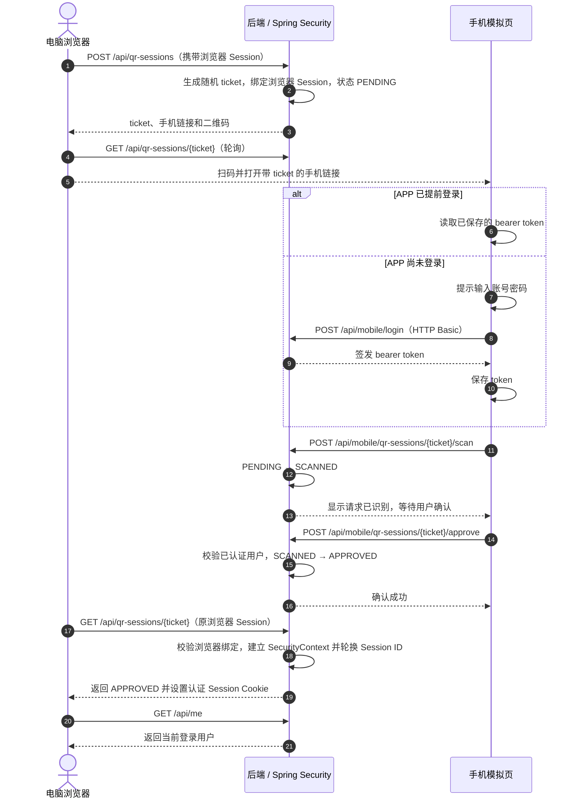

# Spring Security 扫码登录演示

[](https://spring.io/projects/spring-boot)
[](https://openjdk.org/)
[](https://maven.apache.org/wrapper/)
[](LICENSE)

**简体中文** | [English](README.md)

这是一个可运行的自建扫码登录示例，使用 Spring Boot 4.1.2 和 Spring Security。它演示电脑浏览器发起登录、手机端（由网页模拟）识别并确认请求，最后由后端在原浏览器会话中完成登录。

扫码登录不是 Spring Security 开箱即用的功能。Spring Security 在本示例中负责校验账号、保护手机 API、创建和保存电脑端的认证上下文；扫码票据、二维码状态、手机确认以及两个客户端之间的关联由应用代码实现。

## 扫码登录原理

### 参与方与凭证

一次扫码登录涉及电脑浏览器、手机端和后端。流程中有三种不同凭证，不能互相替代：

| 凭证 | 用途 | 示例中的行为 |
| --- | --- | --- |
| 浏览器 HTTP Session（`JSESSIONID`） | 识别发起登录的电脑浏览器 | 后端创建扫码请求时，将请求绑定到当前浏览器会话 |
| 二维码票据（`ticket`） | 找到本次扫码登录请求 | 随机生成，2 分钟过期；票据本身不代表用户已登录 |
| 手机端 bearer token | 证明手机模拟页已登录哪个账号 | 登录模拟 APP 后由后端签发，后续扫码和确认请求携带 |

电脑端页面创建扫码会话并展示二维码。二维码指向带有 `ticket` 的手机页面 URL。手机打开链接后，后端将会话从 `PENDING` 标记为 `SCANNED`；如果手机端尚未登录，用户先登录模拟 APP，页面随后自动执行扫码。用户明确确认后，会话进入 `APPROVED`，并保存由 Spring Security 认证得到的用户名。电脑端原浏览器轮询到批准状态后，后端重新加载用户权限、建立 `SecurityContext`、轮换 Session ID 并保存到该浏览器的 HTTP Session。



状态含义：

- `PENDING`：浏览器已创建请求，尚未扫码。
- `SCANNED`：手机端已识别请求，仍需用户确认。
- `APPROVED`：已登录的手机用户确认了请求，等待原浏览器完成登录。
- `EXPIRED`：超过 2 分钟有效期，必须重新创建二维码。

**扫码不等于登录，确认才是授权。** 手机端只批准绑定到原浏览器的短时请求，不会把手机 bearer token 复制给电脑。只有创建请求时使用的浏览器 Session 能通过轮询完成登录。

## 本地运行

需要 Java 25；项目包含 Maven Wrapper：

```bash
./mvnw spring-boot:run
```

电脑端访问 <http://localhost:8080>。模拟 APP 页面访问 <http://localhost:8080/mobile.html>。本地演示账号为：

```text
用户名：demo
密码：changeit
```

电脑端二维码页面如下。图中的二维码只用于展示页面样式，票据会在 2 分钟内过期；实际操作请启动应用后扫描新生成的二维码。


### 演示一：提前登录模拟 APP

1. 在一个浏览器标签页打开 <http://localhost:8080/mobile.html>。
2. 输入 `demo / changeit` 并点击“登录模拟 APP”。页面显示 `APP 已登录 demo` 后，模拟 APP 已持有 bearer token。
3. 在同一浏览器的另一个标签页打开 <http://localhost:8080>，等待二维码显示。
4. 用手机摄像头/扫码器扫描二维码，或在该浏览器打开二维码中的手机链接。手机端会从同源 `localStorage` 读取已有 token 并自动标记为已扫描。
5. 在手机模拟页核对请求并点击“确认并登录电脑”，回到电脑页查看登录结果。

登录表单和已登录状态示意：


### 演示二：扫码后再登录模拟 APP

此路径模拟手机扫码时 APP 尚未登录的情况。若刚完成演示一，先在模拟 APP 页面点击“退出”；电脑端若已登录，也先退出或使用新的浏览器会话。

1. 在电脑浏览器打开 <http://localhost:8080>，等待新的二维码。
2. 扫描二维码，打开带有 `ticket` 的手机页面链接。
3. 手机页面显示登录表单。输入 `demo / changeit` 并提交。
4. 登录成功后，页面保存 bearer token，并自动用该 token 把当前二维码会话标记为 `SCANNED`；此时才显示确认按钮。
5. 核对请求并点击“确认并登录电脑”，等待电脑端轮询完成登录。

两条路径的差别是手机端何时取得 bearer token。无论哪种情况，扫码后都必须由用户确认，电脑端才会登录。

## 使用真实手机访问

同一浏览器的 `localhost` 页面适合模拟电脑和手机。真实手机访问时，二维码链接中的主机地址必须是手机能够访问的电脑地址，不能使用手机自身的 `localhost`。例如电脑局域网地址为 `192.168.1.20`：

```bash
APP_PUBLIC_BASE_URL=http://192.168.1.20:8080 ./mvnw spring-boot:run
```

确认手机与电脑连接同一网络，且该地址可从手机访问。真实部署必须使用 HTTPS。

## 关键安全设计与示例限制

- **随机、短时票据**：使用 256 位随机值，2 分钟过期，并绑定发起请求的浏览器 Session。
- **明确确认**：扫码只更新状态；批准接口要求手机端经过 Spring Security 认证。
- **独立手机凭证**：模拟 APP 登录使用 HTTP Basic 校验演示账号，后端签发 12 小时 bearer token；扫码和批准通过 bearer token 认证，并需要 CSRF Token。
- **独立过滤链**：手机 API 使用无状态安全链；电脑网页登录使用 HTTP Session，避免模拟手机登录影响电脑浏览器会话。
- **会话固定防护**：电脑端完成扫码登录时轮换 Session ID，再保存认证上下文。

此项目是教学演示，不是生产登录方案：用户、二维码会话和手机 token 都存放在内存中，重启即清空，无法支持多实例。生产环境还需要共享状态存储、并发下的一次性消费、限流与风控、拒绝登录流程、登录设备信息展示和完整的审计能力。不要将示例账号或 HTTP Basic 用于真实账户。

## 主要接口

| 方法 | 路径 | 用途 |
| --- | --- | --- |
| `POST` | `/api/qr-sessions` | 创建绑定当前浏览器 Session 的扫码请求 |
| `GET` | `/api/qr-sessions/{ticket}/qr` | 生成手机端链接的二维码图片 |
| `GET` | `/api/qr-sessions/{ticket}` | 电脑端轮询状态并在批准后完成登录 |
| `POST` | `/api/mobile/login` | 校验模拟 APP 用户并签发 bearer token |
| `POST` | `/api/mobile/qr-sessions/{ticket}/scan` | 手机端将请求标记为已扫描 |
| `POST` | `/api/mobile/qr-sessions/{ticket}/approve` | 使用已认证的手机账号批准登录 |
| `GET` | `/api/me` | 返回电脑浏览器当前登录用户 |
| `POST` | `/api/logout` | 退出电脑端登录 |
| `POST` | `/api/mobile/logout` | 撤销模拟 APP bearer token |

## 配置

| 环境变量 | 默认值 | 说明 |
| --- | --- | --- |
| `SERVER_PORT` | `8080` | HTTP 服务端口 |
| `APP_PUBLIC_BASE_URL` | `http://localhost:8080` | 二维码中手机链接的服务根地址 |
